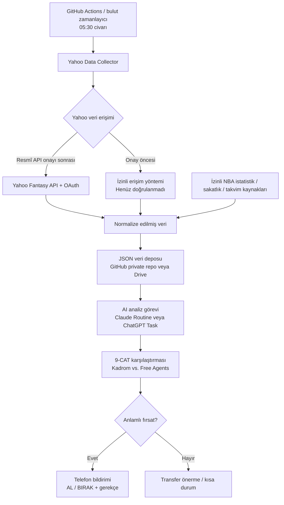

# Fantasy NBA Advisor — Hedef Mimari

## 1. Amaç

Yahoo Fantasy Basketball'daki **8 takımlı H2H 9-CAT** ligini her sabah otomatik analiz etmek; anlamlı bir transfer fırsatı varsa, kullanıcı uyandığında telefonunda **AL / BIRAK** önerisini ve gerekçesini sunmak. Transferler **otomatik yapılmayacak**; son karar kullanıcıya ait.

**Hedef zaman:** Türkiye saatiyle her gün yaklaşık **06.00**. Zamanlanmış bulut işlerinde birkaç dakikalık gecikme olabilir.

**Maliyet hedefi:** Mevcut ChatGPT ve Claude abonelikleri dışında ücretli servis kullanmamak; ücretsiz kotalar içinde kalmak. MacBook geceleri uyku modunda olduğundan iş akışı yerel bilgisayara bağımlı olmamalı.

## 2. Hedef mimari



> **Durum:** Bu bir **hedef mimaridir**, uçtan uca çalıştığı henüz doğrulanmış bir sistem değildir. Özellikle Yahoo verisinin otomatik alınması ve zamanlanmış AI görevinin seçilen depodan dosya okuyabilmesi PoC gerektirir.

## 3. Bileşenler

| Bileşen | Önerilen teknoloji | Sorumluluk |
|---|---|---|
| Orkestrasyon | GitHub Actions (ücretsiz kota) | Sabah veri toplama işini başlatmak |
| Veri toplama | .NET 10 Console / Worker | Yahoo kadro, müsait oyuncu, lig bilgilerini almak |
| Yahoo erişimi | Resmî Fantasy API (onay bekleniyor) | OAuth üzerinden yetkili, salt-okunur veri erişimi |
| Geçici veri erişimi | **Araştırılacak** | API onaylanana kadar izinli ve sürdürülebilir otomatik yöntem bulmak |
| Veri modeli | JSON | Kaynaklardan bağımsız ortak oyuncu/kadro şeması |
| Veri deposu | Özel GitHub repository veya Google Drive | Güncel snapshot'ı saklamak |
| AI analiz | Claude Code Routines **veya** ChatGPT Tasks | Verileri okuyup öneri üretmek; entegrasyon doğrulanacak |
| Bildirim | AI görevi bildirimi veya ücretsiz Telegram botu | Telefon üzerinden raporu iletmek |
| Kod geliştirme | VS Code + Claude Code | Collector, parser, testler, iş akışları |

**n8n zorunlu değil.** Self-hosted Community Edition ücretsiz olsa da ayrıca çalışır bir sunucu gerektirir. İlk sürüm için GitHub Actions daha yalın.

## 4. Günlük iş akışı

1. **05.30 civarı:** GitHub Actions veri toplama işini başlatır.
2. Collector, yetkili Yahoo kaynağından **My Roster**, **Free Agents / Waivers**, lig ayarları ve erişilebilen istatistikleri alır.
3. Gerekirse izinli harici kaynaklardan sakatlık ve maç programı verilerini tamamlar.
4. Verileri normalize edip `collectedAt` zaman damgasıyla JSON olarak saklar.
5. **06.00 civarı:** Seçilen AI görevi en güncel snapshot'ı okur. **Bu okuma entegrasyonu ayrıca test edilecektir.**
6. AI, 9-CAT etkisini ve kadro ihtiyaçlarını karşılaştırır.
7. Anlamlı fırsat varsa **AL / BIRAK**, kategori etkisi, gerekçe, risk ve veri güncelliğiyle bildirim gönderir.
8. Veri eksik/eskiyse öneri uydurmaz; hata veya veri güncelliği uyarısı verir.

## 5. Veri sözleşmesi (örnek)

```json
{
  "collectedAt": "2026-10-30T05:35:00+03:00",
  "source": "yahoo-fantasy",
  "league": { "teams": 8, "scoring": "H2H-9CAT" },
  "roster": [],
  "freeAgents": [],
  "waivers": [],
  "injuries": [],
  "schedule": []
}
```

Her oyuncu için mümkünse `playerId`, `name`, `positions`, `status`, `team`, `gamesPlayed`, `minutes`, `PTS`, `REB`, `AST`, `STL`, `BLK`, `3PM`, `TO`, **FGM/FGA** ve **FTM/FTA** tutulmalı. FG% ve FT% takım bazında doğru hesaplanabilsin diye isabet/deneme adetleri gereklidir.

## 6. Analiz kuralları

- Format: **9-CAT** = PTS, REB, AST, STL, BLK, 3PM, FG%, FT%, TO.
- Mevcut kadro ile müsait oyuncuları karşılaştır; oyuncu değişikliğinin **net kategori etkisini** hesapla.
- Son 7/14 gün formunu sezon ortalamaları ve örneklem büyüklüğüyle birlikte değerlendir.
- Sakatlık, oynama süresi, maç sayısı ve fikstürü dikkate al.
- Sadece anlamlı fırsatlar için öneri üret; her gün zorla transfer önermeye çalışma.
- Öneri **bilgilendirme amaçlıdır**; Yahoo üzerinde otomatik add/drop yapılmaz.
- İleride rakibe karşı haftalık kategori stratejisi eklenebilir.

## 7. Yahoo erişimi — kritik açık konu

- **Kalıcı yol:** Yahoo Fantasy API başvurusunun onaylanması (yaklaşık 1–2 hafta bekleniyor).
- **Araştırma / PoC:** Chrome DevTools'tan **sanitized HAR** dışa aktarılıp burada veya VS Code/Claude Code ile incelenebilir. Bu, veri formatını anlamak içindir; otomatik dahili endpoint kullanımının izinli olduğunu göstermez.
- Web arayüzünde **Available Players** ve **9-CAT istatistikleri** görüntülenebiliyor.
- API öncesinde otomatik toplama için Yahoo'nun kullanım koşullarına uygun, yetkili bir yol doğrulanmadıkça **tam otomasyon garanti edilemez**.
- Çerez, erişim token'ı, oturum bilgisi ve kişisel veriler GitHub deposuna veya analiz dosyalarına konmamalı; sırlar GitHub Actions Secrets gibi güvenli alanlarda tutulmalı.

## 8. AI görevi ve bildirim — doğrulama gerektiren konu

- **Aday A:** Claude Code Routines — mevcut Claude planında zamanlama, repo erişimi ve bildirim yetenekleri doğrulanacak.
- **Aday B:** ChatGPT Tasks — bağlı depodaki **en güncel dosyayı her çalışmada okuyabildiği** gerçek bir zamanlanmış testle doğrulanacak.
- İki seçenek de beklenen erişimi sağlamazsa **C# ile kurallı 9-CAT analiz + Telegram bildirimi** ücretsiz alternatif olarak kullanılacak. Böylece ek LLM API ücreti oluşmaz.
- ChatGPT/Claude aboneliği, ayrı geliştirici API çağrılarının ücretsiz olduğu anlamına gelmez.

## 9. Uygulama planı

### PoC 1 — Veri keşfi
- Yahoo Available Players sayfasında sanitize edilmiş HAR kaydı al.
- HAR içindeki oyuncu verilerini döndüren response'ları tespit et.
- Oyuncu, 9-CAT alanları, filtre ve sayfalama yapısını belgele.
- İzinli otomatik veri erişimi seçeneğini doğrula.

### PoC 2 — AI görevinden veri okuma
- Örnek `fantasy-data.json` dosyasını seçilen depoya koy.
- Claude Routine ve/veya ChatGPT Task ile **zamanlanmış** okuma ve analiz testi yap.
- Bildirimin iPhone'a ulaştığını doğrula.

### MVP
- .NET collector ve normalizasyon.
- GitHub Actions günlük zamanlama.
- Veri güncelliği, hata yönetimi ve güvenli sır saklama.
- 9-CAT transfer raporu ve telefon bildirimi.

### Sonraki aşama
- Yahoo API onayı gelince collector'ı resmî API adaptörüne geçir.
- Rakibe karşı haftalık kategori stratejisi ve geçmiş öneri takibi ekle.

## 10. Başarı kriterleri

- Kullanıcı sabah manuel işlem yapmadan güncel raporu görür.
- Bilgisayarın açık kalması gerekmez.
- Ek ücretli hizmet kullanılmaz; ücretsiz kota sınırları izlenir.
- Öneriler **gerçek lig müsaitliğine** dayanır.
- Eski veya eksik veriyle yanıltıcı transfer önerisi üretilmez.
- Hiçbir transfer kullanıcı onayı olmadan gerçekleştirilmez.
